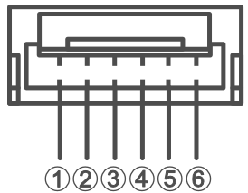

# MyboxesH743 Pro — распиновка и назначение разъёмов

Документация по внешним разъёмам полётного контроллера **MyboxesH743 Pro**.

> [!IMPORTANT]
> Нумерация контактов приведена в соответствии с изображениями распиновки ниже.  
> Перед подключением периферии убедитесь, что правильно определили **контакт 1** и ориентацию разъёма.

<p align="center">
  
</p>

## Расположение и нумерация разъёмов

<p align="center">
  
</p>

<p align="center">
  
</p>

Файлы изображений должны находиться в репозитории по следующим путям:

```text
images/
├── myboxesh743-pro.png
├── connector-pinout-1.png
└── connector-pinout-2.png
```

## Общие обозначения

| Обозначение | Описание |
|---|---|
| `TX` | Передача данных из полётного контроллера |
| `RX` | Приём данных полётным контроллером |
| `CTS` | Вход аппаратного управления потоком UART |
| `RTS` | Выход аппаратного управления потоком UART |
| `SCL` | Тактовая линия шины I²C |
| `SDA` | Линия данных шины I²C |
| `CANH` | Высокая линия дифференциальной шины CAN |
| `CANL` | Низкая линия дифференциальной шины CAN |
| `GND` | Общий провод |
| `VDD` | Напряжение питания внешнего устройства |
| `ARSP` | Аналоговый вход датчика воздушной скорости |
| `RSSI` | Аналоговый вход уровня принимаемого сигнала |

> [!NOTE]
> Направления `TX`, `RX`, `CTS` и `RTS` указаны **относительно полётного контроллера**.  
> Контакт `TX` контроллера подключается к `RX` внешнего устройства, а `RX` контроллера — к `TX` внешнего устройства.

---

## Power1 — основное питание

Разъём основного питания полётного контроллера. Поддерживает измерение напряжения и тока аккумулятора.

| Контакт | Сигнал | Тип | Назначение |
|---:|---|---|---|
| 1 | `GND` | Земля | Общий провод питания |
| 2 | `GND` | Земля | Общий провод питания |
| 3 | `Battery Voltage` | Аналоговый вход | Измерение напряжения аккумулятора |
| 4 | `Battery Current` | Аналоговый вход | Измерение тока аккумулятора |
| 5 | `+5V` | Питание | Основное питание контроллера |
| 6 | `+5V` | Питание | Основное питание контроллера |

---

## Power2 — резервное питание

Разъём резервного питания. Может использоваться как второй независимый вход питания контроллера.

| Контакт | Сигнал | Тип | Назначение |
|---:|---|---|---|
| 1 | `GND` | Земля | Общий провод питания |
| 2 | `GND` | Земля | Общий провод питания |
| 3 | `Battery Voltage` | Аналоговый вход | Измерение напряжения резервного источника |
| 4 | `Battery Current` | Аналоговый вход | Измерение тока резервного источника |
| 5 | `+5V` | Питание | Резервное питание контроллера |
| 6 | `+5V` | Питание | Резервное питание контроллера |

---

## SERIAL1

Полнофункциональный последовательный порт UART с аппаратным управлением потоком.

| Контакт | Сигнал | Тип | Назначение |
|---:|---|---|---|
| 1 | `+5V` | Питание | Питание внешнего устройства |
| 2 | `TX` | Цифровой выход | Передача данных из контроллера |
| 3 | `RX` | Цифровой вход | Приём данных контроллером |
| 4 | `CTS` | Цифровой вход | Разрешение передачи данных внешним устройством |
| 5 | `RTS` | Цифровой выход | Управление передачей данных внешнего устройства |
| 6 | `GND` | Земля | Общий провод |

---

## SERIAL2

Полнофункциональный последовательный порт UART с аппаратным управлением потоком.

| Контакт | Сигнал | Тип | Назначение |
|---:|---|---|---|
| 1 | `+5V` | Питание | Питание внешнего устройства |
| 2 | `TX` | Цифровой выход | Передача данных из контроллера |
| 3 | `RX` | Цифровой вход | Приём данных контроллером |
| 4 | `CTS` | Цифровой вход | Разрешение передачи данных внешним устройством |
| 5 | `RTS` | Цифровой выход | Управление передачей данных внешнего устройства |
| 6 | `GND` | Земля | Общий провод |

---

## SERIAL5

Последовательный порт UART без аппаратного управления потоком.

| Контакт | Сигнал | Тип | Назначение |
|---:|---|---|---|
| 1 | `+5V` | Питание | Питание внешнего устройства |
| 2 | `TX` | Цифровой выход | Передача данных из контроллера |
| 3 | `RX` | Цифровой вход | Приём данных контроллером |
| 4 | `GND` | Земля | Общий провод |

> [!NOTE]
> Интерфейс `SERIAL5` также используется в разъёме `GPS1`.

---

## I2C2

Разъём для подключения внешних датчиков и периферийных устройств по шине I²C.

| Контакт | Сигнал | Тип | Назначение |
|---:|---|---|---|
| 1 | `+5V` | Питание | Питание внешнего устройства |
| 2 | `SCL` | Цифровая линия | Тактовая линия I²C |
| 3 | `SDA` | Цифровая линия | Линия данных I²C |
| 4 | `GND` | Земля | Общий провод |

---

## CAN1

Разъём первой шины CAN.

| Контакт | Сигнал | Тип | Назначение |
|---:|---|---|---|
| 1 | `+5V` | Питание | Питание внешнего CAN-устройства |
| 2 | `CANH` | Дифференциальная линия | Высокая линия CAN |
| 3 | `CANL` | Дифференциальная линия | Низкая линия CAN |
| 4 | `GND` | Земля | Общий провод |

---

## CAN2

Разъём второй шины CAN.

| Контакт | Сигнал | Тип | Назначение |
|---:|---|---|---|
| 1 | `+5V` | Питание | Питание внешнего CAN-устройства |
| 2 | `CANH` | Дифференциальная линия | Высокая линия CAN |
| 3 | `CANL` | Дифференциальная линия | Низкая линия CAN |
| 4 | `GND` | Земля | Общий провод |

> [!TIP]
> На концах физической линии CAN обычно устанавливаются согласующие резисторы. Проверяйте наличие терминации в подключаемых устройствах перед добавлением внешнего резистора.

---

## ADC

Разъём аналоговых входов.

| Контакт | Сигнал | Тип | Назначение |
|---:|---|---|---|
| 1 | `+5V` | Питание | Питание внешнего аналогового датчика |
| 2 | `ARSP` | Аналоговый вход | Вход датчика воздушной скорости; встроенный делитель напряжения `1:2` |
| 3 | `RSSI` | Аналоговый вход | Измерение аналогового уровня RSSI |
| 4 | `GND` | Земля | Общий провод |

> [!WARNING]
> Перед подачей сигнала на аналоговые входы проверьте допустимый диапазон входного напряжения в электрической спецификации контроллера. Наличие делителя `1:2` указано только для входа `ARSP`.

---

## GPS1 / SERIAL5

Основной GPS-разъём. Объединяет последовательный порт `SERIAL5`, шину I²C, линии кнопки безопасности, светодиода и зуммера.

| Контакт | Сигнал | Тип | Назначение |
|---:|---|---|---|
| 1 | `+5V` | Питание | Питание GPS-модуля |
| 2 | `TX` | Цифровой выход | Передача данных из контроллера |
| 3 | `RX` | Цифровой вход | Приём данных контроллером |
| 4 | `SCL` | Цифровая линия | Тактовая линия I²C |
| 5 | `SDA` | Цифровая линия | Линия данных I²C |
| 6 | `SAFETY SWITCH` | Цифровой вход | Сигнал кнопки безопасности |
| 7 | `SAFETY LED` | Цифровой выход | Управление светодиодом кнопки безопасности |
| 8 | `+3.3V` | Питание | Питание низковольтной периферии |
| 9 | `BUZZER` | Выход | Управление внешним зуммером |
| 10 | `GND` | Земля | Общий провод |

> [!IMPORTANT]
> Линии UART разъёма `GPS1` относятся к интерфейсу `SERIAL5`. Учитывайте это при настройке последовательных портов в прошивке.

---

## GPS2 / SERIAL4

Дополнительный GPS-разъём. Объединяет последовательный порт `SERIAL4` и линии I²C.

| Контакт | Сигнал | Тип | Назначение |
|---:|---|---|---|
| 1 | `+5V` | Питание | Питание GPS-модуля |
| 2 | `TX` | Цифровой выход | Передача данных из контроллера |
| 3 | `RX` | Цифровой вход | Приём данных контроллером |
| 4 | `SCL` | Цифровая линия | Тактовая линия I²C |
| 5 | `SDA` | Цифровая линия | Линия данных I²C |
| 6 | `GND` | Земля | Общий провод |

---

## VTX

Разъём подключения аналогового видеопередатчика.

| Контакт | Сигнал | Тип | Назначение |
|---:|---|---|---|
| 1 | `VDD` | Питание | Питание видеопередатчика; напрямую соединено с `VDD` разъёма `CAM` |
| 2 | `Video OUT` | Аналоговый выход | Видеосигнал после прохождения через полётный контроллер |
| 3 | `GND` | Земля | Общий провод |

---

## CAM

Разъём подключения аналоговой камеры.

| Контакт | Сигнал | Тип | Назначение |
|---:|---|---|---|
| 1 | `VDD` | Питание | Питание камеры; напрямую соединено с `VDD` разъёма `VTX` |
| 2 | `Video IN` | Аналоговый вход | Вход видеосигнала от камеры |
| 3 | `GND` | Земля | Общий провод |

> [!WARNING]
> Контакты `VDD` разъёмов `CAM` и `VTX` электрически соединены напрямую. Напряжение питания камеры и видеопередатчика должно быть совместимо с обоими устройствами.

---

## Подключение периферии

Перед подключением нового устройства:

1. Отключите питание полётного контроллера.
2. Проверьте ориентацию разъёма и положение контакта 1.
3. Сверьте напряжение питания внешнего устройства.
4. Для UART соедините `TX` одного устройства с `RX` другого.
5. Для CAN соединяйте `CANH` с `CANH`, а `CANL` с `CANL`.
6. Убедитесь, что все устройства имеют общий `GND`.
7. После подключения проверьте назначение интерфейса в настройках прошивки.

## Лицензия и обратная связь

При обнаружении ошибки в распиновке создайте Issue в репозитории и укажите:

- название разъёма;
- номер контакта;
- ожидаемый сигнал;
- версию аппаратной платы.
