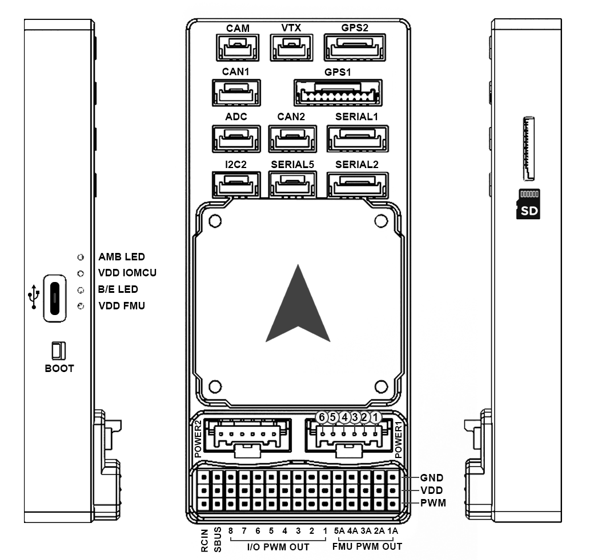

# MyboxesH743 Pro — Pinout

  

## Расположение разъёмов

  

  

> **Примечание:** нумерация контактов указана на изображениях выше. Направления `TX`, `RX`, `CTS` и `RTS` указаны относительно полётного контроллера. Логические сигналы — `3.3 В`, если не указано иное.

---

## Power1 (MAIN)

| Контакт | Сигнал | Напряжение | Примечание |
|---:|---|---:|---|
| 1 | GND | 0 В | — |
| 2 | GND | 0 В | — |
| 3 | Battery Voltage | Аналоговый вход | Измерение напряжения аккумулятора |
| 4 | Battery Current | Аналоговый вход | Измерение тока аккумулятора |
| 5 | +5V | +5 В | Основное питание |
| 6 | +5V | +5 В | Основное питание |

## Power2 (Backup)

| Контакт | Сигнал | Напряжение | Примечание |
|---:|---|---:|---|
| 1 | GND | 0 В | — |
| 2 | GND | 0 В | — |
| 3 | Battery Voltage | Аналоговый вход | Измерение напряжения аккумулятора |
| 4 | Battery Current | Аналоговый вход | Измерение тока аккумулятора |
| 5 | +5V | +5 В | Резервное питание |
| 6 | +5V | +5 В | Резервное питание |

## SERIAL1

| Контакт | Сигнал | Напряжение | Примечание |
|---:|---|---:|---|
| 1 | +5V | +5 В | Питание периферии |
| 2 | TX | 3.3 В | Выход контроллера |
| 3 | RX | 3.3 В | Вход контроллера |
| 4 | CTS | 3.3 В | Вход контроллера |
| 5 | RTS | 3.3 В | Выход контроллера |
| 6 | GND | 0 В | — |

## SERIAL2

| Контакт | Сигнал | Напряжение | Примечание |
|---:|---|---:|---|
| 1 | +5V | +5 В | Питание периферии |
| 2 | TX | 3.3 В | Выход контроллера |
| 3 | RX | 3.3 В | Вход контроллера |
| 4 | CTS | 3.3 В | Вход контроллера |
| 5 | RTS | 3.3 В | Выход контроллера |
| 6 | GND | 0 В | — |

## SERIAL5

| Контакт | Сигнал | Напряжение | Примечание |
|---:|---|---:|---|
| 1 | +5V | +5 В | Питание периферии |
| 2 | TX | 3.3 В | Выход контроллера |
| 3 | RX | 3.3 В | Вход контроллера |
| 4 | GND | 0 В | — |

## I2C2

| Контакт | Сигнал | Напряжение | Примечание |
|---:|---|---:|---|
| 1 | +5V | +5 В | Питание периферии |
| 2 | SCL | 3.3 В | Тактовая линия I2C |
| 3 | SDA | 3.3 В | Линия данных I2C |
| 4 | GND | 0 В | — |

## CAN1

| Контакт | Сигнал | Напряжение | Примечание |
|---:|---|---:|---|
| 1 | +5V | +5 В | Питание периферии |
| 2 | CANH | CAN | — |
| 3 | CANL | CAN | — |
| 4 | GND | 0 В | — |

## CAN2

| Контакт | Сигнал | Напряжение | Примечание |
|---:|---|---:|---|
| 1 | +5V | +5 В | Питание периферии |
| 2 | CANH | CAN | — |
| 3 | CANL | CAN | — |
| 4 | GND | 0 В | — |

## ADC

| Контакт | Сигнал | Напряжение | Примечание |
|---:|---|---:|---|
| 1 | +5V | +5 В | Питание датчика |
| 2 | ARSP | Аналоговый вход | Делитель напряжения 1:2 |
| 3 | RSSI | Аналоговый вход | Аналоговый RSSI |
| 4 | GND | 0 В | — |

## GPS1 / SERIAL5

| Контакт | Сигнал | Напряжение | Примечание |
|---:|---|---:|---|
| 1 | +5V | +5 В | Питание GPS |
| 2 | TX | 3.3 В | SERIAL5 TX |
| 3 | RX | 3.3 В | SERIAL5 RX |
| 4 | SCL | 3.3 В | I2C |
| 5 | SDA | 3.3 В | I2C |
| 6 | SAFETY SWITCH | 3.3 В | Вход кнопки безопасности |
| 7 | SAFETY LED | 3.3 В | Выход светодиода |
| 8 | +3.3V | +3.3 В | Питание |
| 9 | BUZZER | 0–5 В | Выход зуммера |
| 10 | GND | 0 В | — |

## GPS2 / SERIAL4

| Контакт | Сигнал | Напряжение | Примечание |
|---:|---|---:|---|
| 1 | +5V | +5 В | Питание GPS |
| 2 | TX | 3.3 В | SERIAL4 TX |
| 3 | RX | 3.3 В | SERIAL4 RX |
| 4 | SCL | 3.3 В | I2C |
| 5 | SDA | 3.3 В | I2C |
| 6 | GND | 0 В | — |

## VTX

| Контакт | Сигнал | Напряжение | Примечание |
|---:|---|---:|---|
| 1 | VDD | Сквозное питание | Напрямую соединено с VDD CAM |
| 2 | Video OUT | Аналоговый сигнал | Выход видеосигнала |
| 3 | GND | 0 В | — |

## CAM

| Контакт | Сигнал | Напряжение | Примечание |
|---:|---|---:|---|
| 1 | VDD | Сквозное питание | Напрямую соединено с VDD VTX |
| 2 | Video IN | Аналоговый сигнал | Вход видеосигнала |
| 3 | GND | 0 В | — |
